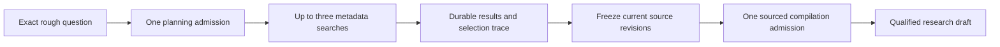

# Research from a rough question

You can now start with a question or passing observation without choosing reports, asserting a thesis or starting monitoring. The internal workflow names material questions and counter-evidence, searches a bounded metadata source, retains the selection trace, then asks the selected model for evidence-qualified drivers and possible exposure routes.

This first path uses GDELT headlines and metadata. It does not retrieve linked articles, verify prices, establish a macro regime or confirm that an instrument is available. A result can leave the idea unresolved or offer no defensible exposure candidate.

## Set up and run

Complete [local setup](GETTING_STARTED.md) and [provider setup](THESIS_COMPILATION.md). Load the database and provider configuration in the backend terminal, then enable the internal research and capture paths:

```sh
export MACRO_ENABLE_MODEL_COMPILATION=1
export MACRO_ENABLE_MONITORING_PROOF=1
export MACRO_ENABLE_RESEARCH_DISCOVERY=1
.venv/bin/python manage.py migrate --noinput
.venv/bin/python manage.py runserver 127.0.0.1:8000
```

Research does not require a continuous watch or the synthetic setup flag. Before paying for planning, check that the metadata source works from the configured backend terminal:

```sh
.venv/bin/python manage.py research_check_source --query "helium supply" --recovery-policy
```

This makes one bounded metadata request using the twenty-second recovery transport policy, with no model key, model call, database write or retry. It prints a safe failure category or parsed candidate counts. A successful empty response is not evidence against an idea; successful acquisition does not establish coverage or source suitability. This check is separate from the paid graph, which can incur its planning charge before a source failure is discovered.

Then, from a second terminal:

```sh
.venv/bin/python tools/research_question.py --question "Research possible helium exposure and what could undermine the idea."
```

Alternatively, use `--question-file path/to/question.txt` to preserve UTF-8 text and line endings exactly, or omit both options to enter a question interactively. Log in, select a model from the configured provider catalogue and inspect the request before starting it. Generated search expressions go to GDELT; the exact question and retained evidence go to the selected model provider. There is no provider-specific search suffix or separate search key.

The terminal prints the request UUID before transmission and writes a private journal. It shows the named questions, counter-evidence sought, queries, all returned candidate identities, exclusions, retained evidence, source-linked proposals, costs and gaps. A related business may lose from a commodity disruption rather than benefit; exposure candidates must explain that relationship and basis risk.

New terminal runs explicitly enable [source recovery](RESEARCH_SOURCE_RECOVERY.md). Add `--wait` to follow saved cooldowns within a local time budget, or resume later with `--continue-run`. At most three source GET attempts per question are allowed; paid planning and compilation are not automatically repeated. The source deadline is thirty minutes. Legacy runs and omitted-option HTTP requests preserve the one-shot contract.

## Bounded graph



The graph permits at most two model calls, three named questions, five search candidates per successful lookup and four selected reports per question. The complete evidence set contains at most twelve reports. Opted-in source recovery permits at most nine GET attempts across those questions. The search window is thirty days relative to acquisition, so a later retry is not an original-time historical snapshot. These bounds are pinned in the research request and adapter contract; they do not establish complete coverage or a dollar ceiling.

The user approved [pilot search limits](RESEARCH_SOURCE_RECOVERY.md#approved-pilot-search-budget) of USD 10 per UTC calendar month shared across the pilot, and USD 0.10 per investigation, excluding model inference and subscription fees. An internal reservation ledger now enforces these accounting bounds, while paid transport integration and provider terms remain outstanding. [Background enrollment](RESEARCH_BACKGROUND.md) separately delegates remaining work of already-planned recovery runs to a bounded operator process.

Selection follows the provider's returned ranking within each planned question. The fifth result, duplicates and unsafe attribution URLs remain explicitly excluded in the trace. Reaching the candidate cap is visible. There is no independent semantic source-quality ranker or guarantee that contrary evidence was found. [GDELT's DOC documentation](https://blog.gdeltproject.org/gdelt-doc-2-0-api-debuts/) describes its query and ranking behavior.

New research packets also carry the exact retained plan and every completed query outcome into final synthesis, including empty searches, candidate caps, exclusions and selected revision references. Every consumed query source retains its permission contract and is protected during fresh use, including sources with no selected report. This versioned workflow context is separate from source claims and trader intent. Zero returned results do not establish that a competing explanation is false or adequately investigated. Headlines cannot supply article-level mechanisms merely because a model can quote them. The complete packet keeps the existing byte bound and rejects overflow without truncation; earlier packets and prompts retain their original identities.

GDELT seen time is retained separately from system receipt and conservative durable observation. Publisher publication time stays unknown, rather than being invented from the seen timestamp. Source statements and exact quotations establish attribution, not truth, semantic support or causation. [GDELT's terms](https://www.gdeltproject.org/about.html#termsofuse) cover its released datasets; linked publisher article rights are not inferred. This adapter is an internal metadata experiment, not a production source selection.

## Recovery

If the response is lost, inspect the saved command without sending another model or search request:

```sh
.venv/bin/python tools/research_question.py --recover-command COMMAND_UUID
.venv/bin/python tools/research_question.py --show-run RESEARCH_UUID
```

The original start command is also inert on retry. It reads saved state rather than advancing the graph. To explicitly advance nodes that have not yet been admitted:

```sh
.venv/bin/python tools/research_question.py --continue-run RESEARCH_UUID
```

Continuation first reads the saved state. It can incur a charge for a not-yet-admitted node, so the terminal asks before sending the continuation. An admitted uncertain paid call is never resent. Discovery receipts and committed captures can be adopted after restart without another search. Recovery-enabled source failures can advance only after their saved cooldown and within attempt/deadline limits. Legacy failed searches and malformed or uncertain paid nodes remain terminal. Read-only recovery never advances either graph.

Source corrections or permission withdrawal make consumed evidence stale. Original questions, plans, candidate logs and model outputs remain retained. A changed draft cannot silently replace the question's input. Unknown costs stay null; planning and compilation share the existing private-call allowance.

## Authority and privacy

The request is an immutable research record linked to a private, unapproved question-backed draft so it can reuse compilation and refinement. That implementation does not infer trader belief. Proposals remain separate from exact input. Approval, positions and monitoring require their existing explicit commands.

Per-question research sources contain private query context. Ownership is enforced when admitting and reconstructing evidence, including at the database membership boundary. Staff status does not bypass private-row scope. Research-only source eligibility does not add GDELT to continuous source catalogues or allow a watch to enroll it.

The session API exposes:

- `POST /api/v1/research/`, required `command_id`, `exact_question`, `provider_id`, `model_id`, and optional strict `source_recovery`.
- `GET /api/v1/research/{run_id}/`.
- `GET /api/v1/research-commands/{command_id}/`.
- `POST /api/v1/research/{run_id}/continue/`, with an empty JSON object.

The start endpoint also accepts strict optional `source_recovery: true`. It pins the reviewed source policy and changes the request identity. Omission keeps the legacy contract; a saved command cannot change that flag. Recovery responses expose the execution policy, source deadline, next eligible time and all numbered source attempts.

Writes require CSRF and reject unknown fields, duplicate keys and coercion. Reads make no provider, catalogue or search call. The [initial recorded proof](../artifacts/question-research-trace-2026-10-18.md) uses fictional inputs, including restart after capture. The [context-continuity proof](../artifacts/question-research-context-trace-2026-10-19.md) adds saturated and empty query outcomes reaching synthesis with exact recovery. Primary-source investigation, source-fit evaluation, deeper company research and supervised live usefulness remain ahead.

## Live validation status

The 2026-10-18 real GDELT transport probe resolved DNS but timed out during TLS setup from this environment. No model request or database write was made. Recorded acquisition and recovery tests pass; actual live acquisition and usefulness still need validation. The workflow retains source failures explicitly rather than manufacturing a research conclusion.

A 2026-10-19 recheck through the actual adapters timed out at GDELT after ten seconds while the Fed adapter parsed twenty items. [The recheck](../research/research-source-recheck-2026-10-19.md) records the scope and replacement-source constraints. The Fed feed can support a Fed-answerable selected-packet test through [source-backed compilation](SOURCED_RESEARCH.md); it cannot replace broad commodity or company research. No alternative provider or continuous watch was enabled.
